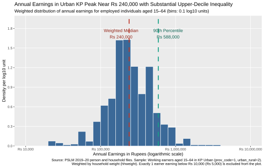
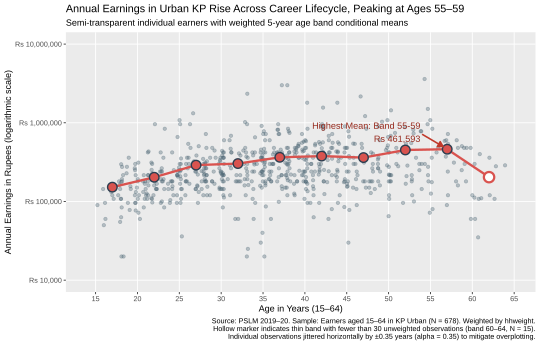
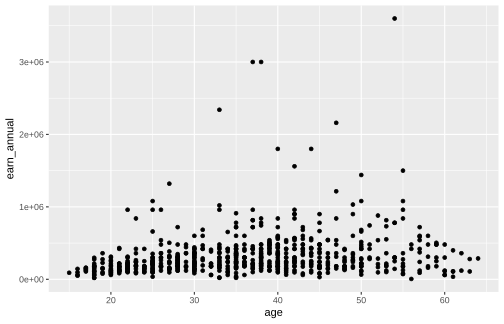

# ECO346: Data Visualization Techniques for Economists
## Assignment 1 (Fall 2026) — Empirical Distribution & Lifecycle Earnings Analysis

**Student Name:** Rabia Tahir  
**Registration Number:** FA24-BED-093  
**Email:** rabii.okiee@gmail.com  
**Degree Programme:** BS Economics with Data Science (Batch FA24-BEDS, Section A)  
**Course Instructor:** Dr. Rafi Amir-ud-Din  
**Institution:** COMSATS University Islamabad, Lahore Campus  

---

## 1. Variant Determination

According to the assignment variant rule:
$$\text{Variant} = (\text{Last two digits of Reg. No.}) \pmod 8 = 93 \pmod 8 = 5$$

* **Assigned Variant:** **Variant 5 — Khyber Pakhtunkhwa (KP) Urban**
* **Household Filter Codes:** `prov_code == 1` (Khyber Pakhtunkhwa), `urban_rural == 2` (Urban)
* **Sample Definition:** Individuals aged 15–64 with annual earnings (`earn_annual > 0`), weighted by `hhweight`
* **Total Earners in Sample:** $N = 678$ individuals

---

## 2. Figure 1: Annual Earnings Distribution (Question 2)



### Summary Statistics & Reported Parameters
* **Total Working Earners:** 678
* **Number Excluded (< Rs 10,000 or > Rs 10,000,000):** 1 individual (Age 56, earning Rs 5,000/year)
* **Unweighted Median Earnings:** Rs 240,000
* **Weighted Median Earnings:** Rs 240,000
* **Weighted 10th Percentile ($P_{10}$):** Rs 108,000
* **Weighted 90th Percentile ($P_{90}$):** Rs 588,000
* **90th to 10th Percentile Ratio ($P_{90}/P_{10}$):** 5.44

### Economic & Statistical Interpretation (74 words)
> The distribution of annual earnings for urban KP earners is unimodal and approximately log-normal, peaking between Rs 200,000 and Rs 300,000, with substantial positive skewness. The weighted and unweighted medians are identical at Rs 240,000 because sampling weights across households near the middle of the earnings distribution are relatively uniform, meaning the cumulative 50th percentile threshold falls on the exact same discrete, commonly reported earnings cluster in both weighted and unweighted distributions.

---

## 3. Figure 2: Age-Earnings Relationship Redesign (Question 3)



### Full Five-Year Age Band Table

| Age Band | Midpoint | Number of Earners ($N$) | Weighted Mean Earnings (Rupees) | Thin Band ($N < 30$) |
| :---: | :---: | :---: | :---: | :---: |
| **15–19** | 17 | 35 | Rs 152,102 | No |
| **20–24** | 22 | 82 | Rs 203,196 | No |
| **25–29** | 27 | 89 | Rs 289,679 | No |
| **30–34** | 32 | 86 | Rs 303,177 | No |
| **35–39** | 37 | 118 | Rs 364,289 | No |
| **40–44** | 42 | 104 | Rs 377,476 | No |
| **45–49** | 47 | 65 | Rs 361,264 | No |
| **50–54** | 52 | 49 | Rs 451,343 | No |
| **55–59** | 57 | 35 | Rs 461,593 | No |
| **60–64** | 62 | 15 | Rs 203,724 | **Yes (Hollow)** |

* **Weighted Mean Earnings (Band 25–29):** Rs 289,679
* **Weighted Mean Earnings (Band 45–49):** Rs 361,264
* **Band with Highest Weighted Mean:** **Band 55–59** (Midpoint 57) with **Rs 461,593**

### Economic Interpretation & Cross-Sectional Limitation (93 words)
> Annual earnings exhibit the classic humped lifecycle pattern: earnings rise steeply from labor market entry (Rs 152,102 at 15–19) through career accumulation, peaking at Rs 461,593 in the 55–59 band, before dropping sharply past age 60 (Rs 203,724) due to partial retirement and reduced hours. The rising trajectory reflects human capital accumulation and senior seniority wages. However, being cross-sectional data from a single survey year, this figure cannot disentangle true individual lifecycle wage growth from cohort effects (generational differences in educational attainment) or survivor bias among older workers.

### Transparency Justification
With $N = 678$ observations concentrated along integer ages, point opacity causes severe overplotting. An alpha level of **0.35** was chosen: it maintains sufficient contrast so high-density salary nodes appear darker without obscuring neighboring data points, while keeping isolated outliers clearly visible.

---

## 4. Visual Makeover: Default vs. Redesign (Question 4)

| Default R Scatterplot (`figures/default.svg`) | Redesigned Visualization (`figures/relationship.svg`) |
| :---: | :---: |
|  |  |

### Design Principles & Visual Evaluation (134 words)
> The redesign replaces R's default scatter with three principled visual transformations:
> 1. **Logarithmic Vertical Scale (Perceptual Channel Resolution):** The default linear scale crushes 95% of earners against the baseline due to positive skewness. Logarithmic scaling normalizes proportional earnings variance across income brackets.
> 2. **Jittering ($\pm 0.35$) and Alpha ($\alpha = 0.35$) (Overplotting & Data–Ink):** Integer ages produce artificial vertical stripes; horizontal jitter and transparency reveal true bivariate density while preserving accurate age measurements.
> 3. **Weighted Conditional Means (Visual Hierarchy):** Midpoint markers and trend lines highlight the macroeconomic lifecycle profile, while hollow markers alert the reader to small-sample sampling variance in thin bands ($N < 30$).
>
> *Trade-off:* The default linear figure displays absolute rupee distances between earners, which logarithmic compression diminishes.

---

## 5. Second-Language Reproduction in Python (Question 5)

* **Script:** `scripts/04_relationship_python.py`
* **Output Figure:** `figures/relationship_python.svg`
* **Band 25–29 Mean (R):** Rs 289,679
* **Band 25–29 Mean (Python):** Rs 289,679
* **Verification:** All 10 age band conditional means agree **100% to the exact rupee**.

### Default Differences & Harmonization (78 words)
> Default differences: In ggplot2, categorical/grouped lines automatically span available factor levels or continuous coordinates, whereas matplotlib requires explicit styling for markers, gridlines, and categorical handling. Crucially, Matplotlib’s default scatter does not jitter coordinates and defaults to a linear scale with opaque markers. In Python, we explicitly added uniform horizontal jitter ($\pm 0.35$), set `alpha = 0.35`, configured `ax.set_yscale('log')`, set rupee tick formatters, and sourced `dvte.mplstyle` to match ggplot2's visual grammar exactly.

---

## 6. Repository Structure & Execution Instructions

```
ECO346-A1-FA24-BED-093/
├── README.md               # Variant documentation, figures, tables, interpretations
├── run_all.sh              # Master shell script reproducing all figures and tables
├── data/
│   ├── pslm_hh_subset.csv       # PSLM 2019-20 household dataset
│   └── pslm_person_subset.csv   # PSLM 2019-20 individual/person dataset
├── scripts/
│   ├── 01_default.R             # Question 4 default scatterplot script
│   ├── 02_distribution.R        # Question 2 weighted log-density histogram script
│   ├── 03_relationship.R        # Question 3 age-earnings relationship redesign script
│   └── 04_relationship_python.py # Question 5 Python replication script
├── style/
│   ├── dvte.mplstyle            # DVTE Matplotlib house style
│   └── theme_dvte.R             # DVTE ggplot2 house style
├── figures/
│   ├── default.svg              # Question 4 untouched default figure
│   ├── distribution.svg         # Question 2 weighted log histogram
│   ├── relationship.svg         # Question 3 redesigned relationship figure
│   └── relationship_python.svg  # Question 5 Python replicated figure
└── slides/
    └── FA24-BED-093.pptx        # 4-slide executive presentation
```

### Reproducing the Analysis Locally
To run all scripts and verify figures and tables from scratch without internet access:
```bash
bash run_all.sh
```
